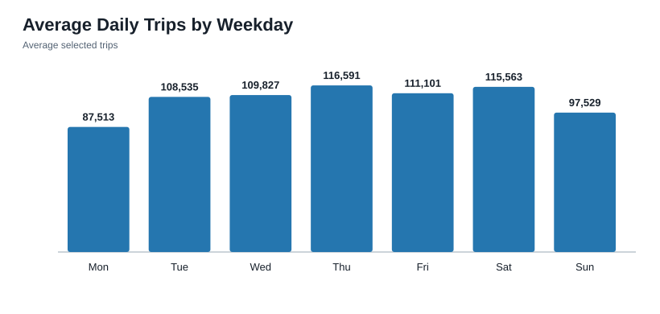
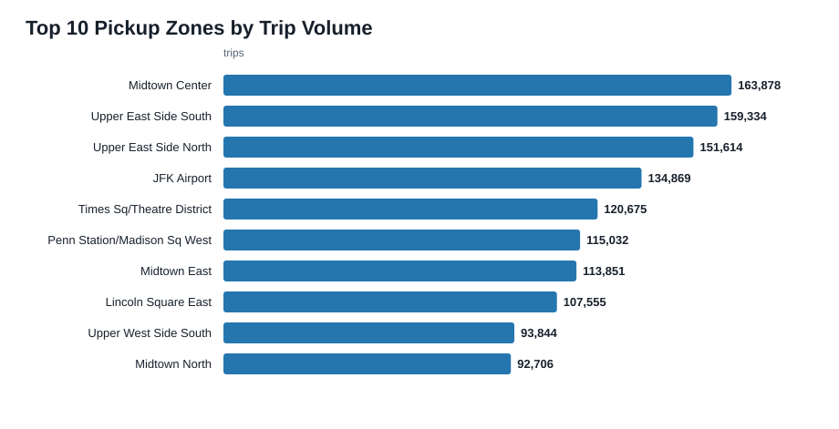
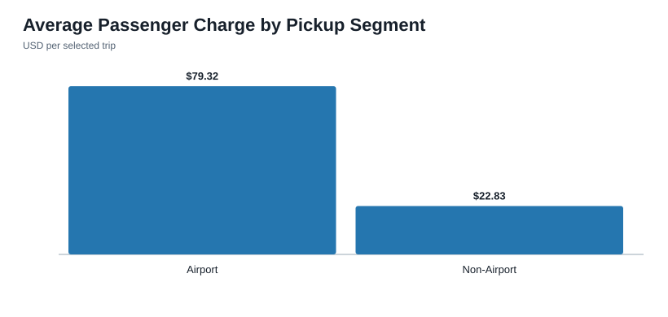
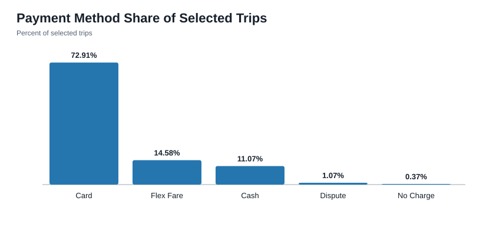
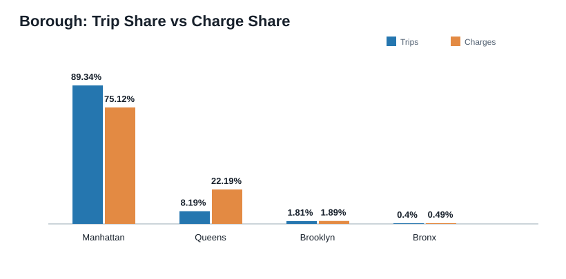

# NYC Taxi Operations & Revenue Intelligence

**Advanced SQL Analytics Portfolio Project**  
**SQL Server · T-SQL · Python · PyArrow · Data Quality · Business Intelligence**

An end-to-end analytical case study of **January 2025 NYC Yellow Taxi trip records**. The project uses official public trip data, loads it into Microsoft SQL Server, investigates data-quality issues, and uses T-SQL to answer business questions about passenger charges, demand, pickup locations, airport trips, travel behavior, and recorded tipping.

> **Business context:** This is an independent analysis of publicly released TLC records, not a project conducted for NYC TLC or a taxi operator. The figures below come from SQL Server query outputs reviewed during the project. This packaged repository has not itself been rerun end-to-end on a separate SQL Server instance.

## Results at a glance

| Metric | January 2025 result |
|---|---:|
| Source Yellow Taxi records | **3,475,226** |
| Records with January pickup date | **3,475,204** |
| Trips in the positive-charge analytical subset | **3,324,156 (95.65%)** |
| Excluded from that subset | **151,070 (4.35%)** |
| Total recorded passenger charges | **$88,388,329.76** |
| Total fare amount | **$58,962,690.44** |
| Average recorded charge per selected trip | **$26.59** |
| Busiest pickup hour | **6 PM (242,232 trips)** |
| Highest-volume pickup zone | **Midtown Center (163,878 trips)** |
| Airport pickup share of selected trips | **6.66%** |
| Airport pickup share of passenger charges | **19.87%** |
| Operationally filtered average distance | **3.17 miles** |
| Final pickup-zone JOIN reconciliation | **0 trips / $0.00 difference** |

**Metric definition:** `total_amount` is the *recorded amount charged to passengers*, not net company revenue, net income, or profit. The selected-trip subset is an **analytical rule**, not an official TLC determination of trip validity.

## Business problem

How can a transportation analyst use trip-level records to understand **when and where trips occur**, what drives differences in **recorded charges**, and how **data-quality problems** affect operational KPIs? The analysis focuses on *observed completed trips*. It cannot measure unmet demand, fleet availability, actual driver profitability, or causality.

## Business questions and SQL analyses

The following questions are answered in **[`NYC Taxi.sql`](NYC%20Taxi.sql)**. Each analysis is introduced by a short SQL comment.

| # | Analysis | Business question | SQL techniques |
|---:|---|---|---|
| 01 | Data Quality Assessment | Are trip dates, distances, passenger charges, and locations complete and plausible? | `CASE`, conditional aggregation |
| 02 | Valid Trips & Quality Rate | What proportion of source records meets the analytical inclusion criteria? | CTE, `CASE`, percentage calculation |
| 03 | Revenue Summary | What are total passenger charges, total fares, and average charges per selected trip? | `SUM`, `AVG`, `COUNT_BIG` |
| 04 | Daily Revenue Trends | How do recorded passenger charges and trip volumes change day by day? | CTE, `LAG()` |
| 05 | Weekday Performance | Which weekdays have the highest *average daily* demand and charges? | `DATENAME`, grouping, daily normalization |
| 06 | Peak Hours Performance | Which pickup hours have the most completed trips? | `DATEPART`, `DENSE_RANK()` |
| 07 | Top Pickup Zones by Demand | Which pickup zones contribute the most trips? | `JOIN`, CTE, `DENSE_RANK()` |
| 08 | Top Pickup Zones by Charges | Which pickup zones lead by total recorded passenger charges? | `JOIN`, aggregation, ranking |
| 09 | Airport vs Non-Airport Trips | How do JFK/LaGuardia pickup trips compare with other pickups in charge, distance, and duration? | `CASE`, `JOIN`, derived duration |
| 10 | Airport Fare & Surcharges | How do fare, tip, airport fee, toll, and congestion-charge components differ by pickup segment? | Conditional segmentation, averages |
| 11 | Trip Distance & Duration | How are trips distributed across distance bands, and how do duration and charges vary? | `CASE`, windowed share |
| 12 | Operational Efficiency & Speed | What are distance, duration, and estimated speed after applying explicit operational filters? | CTE, `DATEDIFF_BIG`, derived ratios |
| 13 | Payment Methods & Tipping | How do recorded payment categories and recorded tip rates differ? | `CASE`, grouped KPIs, window percentages |
| 14 | Top Pickup-to-Dropoff Routes | Which origin-destination zone pairs have the most completed trips? | Two `JOIN`s, CTE, `DENSE_RANK()` |
| 15 | Borough Demand & Charges Ranking | How does each pickup-borough category rank in trip share versus charge share? | CTE, `SUM() OVER`, `DENSE_RANK()` |

**Additional investigations within the same SQL file:** trip-distance outlier counts, inspection of extreme-distance records, original payment-type code distribution, and final pickup-zone JOIN reconciliation. These support the 15 main analyses rather than inflating their count.

## Key business findings

### 1. Demand peaks are concentrated in particular hours and areas

- **Thursday** had the highest average daily trip count (**116,591** selected trips per Thursday in this month).
- **6 PM** had the most pickups (**242,232** over January); **5 PM** was second (**233,330**).
- **Midtown Center** led pickup zones by volume with **163,878** trips.
- The busiest observed pickup-to-dropoff route was **Upper East Side South → Upper East Side North**, with **24,457** trips.

**Interpretation:** these are observed trip patterns, not proof of unmet demand or a prescription to increase fleet supply without further operational data.

### 2. Airport pickups generate disproportionately high recorded charges

| Metric | JFK / LaGuardia pickup trips | Other pickup zones |
|---|---:|---:|
| Trips | 221,379 | 3,102,777 |
| Total recorded passenger charges | $17,559,227.72 | $70,829,102.04 |
| Average passenger charge | $79.32 | $22.83 |
| Average fare | $58.54 | $14.83 |
| Average distance (initial subset) | 13.30 mi | 5.51 mi |
| Average duration | 34.38 min | 13.76 min |
| Average recorded tip | $9.22 | $2.61 |
| Average tolls | $3.92 | $0.23 |

Airport pickup trips made up **6.66% of selected trips** but **19.87% of charges**. Higher fares, longer rides, and tolls are associated with higher average charges. These results do **not** establish airport-trip profitability or isolate a causal effect.

### 3. Data quality can materially change operational averages

| Quality check | Result |
|---|---:|
| Missing pickup/dropoff timestamps | 0 |
| Nonpositive trip durations | 2,051 |
| Missing or nonpositive distances | 90,893 |
| Missing or negative `total_amount` | 63,037 |
| Missing pickup/dropoff location IDs | 0 |
| Selected trips with distance greater than 50 mi | 509 |
| Selected trips with distance greater than 100 mi | 158 |
| Maximum recorded distance | 276,423.57 mi |
| Maximum recorded trip duration | 5,626.32 min |

The initial analytical subset averaged **6.03 miles** per trip. A separate operational subset (duration **1–180 minutes**, distance **at most 100 miles**, estimated speed **at most 80 mph**) retained **3,312,975** trips, and averaged **3.17 miles**, **14.72 minutes**, and **11.33 mph** (mean of individual trip estimates). Those thresholds are **analyst assumptions**, not NYC TLC rules. The original records are not deleted.

**Why this matters:** a small number of implausible distances can significantly bias the average; distance and speed metrics require their own documented validation rules.

### 4. Payment categories require careful interpretation

| Payment type | Trips | Share | Avg recorded tip |
|---|---:|---:|---:|
| Credit Card | 2,423,611 | 72.91% | $4.10 |
| Flex Fare (code 0) | 484,618 | 14.58% | $0.47 |
| Cash | 368,149 | 11.07% | $0.00 |
| Dispute | 35,599 | 1.07% | $0.01 |
| No Charge | 12,179 | 0.37% | $0.00 |

**94.33%** of card trips had a positive recorded tip. Cash tips are not fully captured by the public trip records: a recorded zero is **not** evidence that no cash tip was given. Raw code `0` was investigated and labeled **Flex Fare**, instead of being incorrectly treated as missing.

### 5. Geography creates different volume and charge profiles

- Manhattan: **89.34% of selected trips** and **75.12% of recorded passenger charges**.
- Queens: **8.19% of trips** and **22.19% of charges**, consistent with high-charge airport pickup activity.
- The lookup also includes non-standard borough labels such as **EWR**, **N/A**, and **Unknown**. These are preserved rather than silently reallocated.

## Reproduced results and charts

The saved CSV excerpts reflect the **original** SQL Server analytical population (**3,324,156** selected trips). They let reviewers inspect findings without installing SQL Server. The results are descriptive, not causal.

**Result tables:** [KPI summary](results/original_sql_kpi_summary.csv) · [Weekday performance](results/original_sql_weekday_performance.csv) · [Top pickup zones](results/original_sql_top_pickup_zones.csv) · [Airport segments](results/original_sql_airport_segments.csv) · [Payment mix](results/original_sql_payment_mix.csv) · [Borough ranking](results/original_sql_borough_ranking.csv).

### Demand by weekday



### Top pickup zones



### Airport versus non-airport average charges



### Payment method share



### Borough share of trips and charges



**Hourly demand:** The full 24-hour SQL analysis is available in [`NYC Taxi.sql`](NYC%20Taxi.sql). A four-hour excerpt is intentionally not presented as a complete hourly distribution. Run the query and export its full result for a 24-hour visualization.

## KPI methodology & validation

**Baseline trip subset** used for most commercial/demand metrics:

```sql
WHERE pickup_datetime >= '2025-01-01'
  AND pickup_datetime < '2025-02-01'
  AND dropoff_datetime > pickup_datetime
  AND trip_distance > 0
  AND total_amount > 0
  AND pu_location_id IS NOT NULL
  AND do_location_id IS NOT NULL
```

This is a **positive-charge trip filter**, not a general-purpose cleansing policy. Multiple failed quality tests can overlap, so their counts must not be summed to derive the exclusion count.

**Operational metrics** additionally use the duration, distance, and speed thresholds above. Initial-distance means remain available for comparison, but should not be interpreted as robust operational estimates.

**Reconciliation:** the pickup-zone JOIN produced **3,324,156 records** and **$88,388,329.76** in charges, matching the baseline subset exactly (**0 trip** and **$0.00** difference). This validates the totals for that join, not every data assumption.

## Technology and workflow

```text
Official NYC TLC Yellow Taxi Parquet + Taxi Zone Lookup CSV
                         |
                         v
                Python / PyArrow / pyodbc
                         |
                         v
                Microsoft SQL Server
               NYC_Taxi_Analytics
        dbo.yellow_trips_raw + dbo.taxi_zones
                         |
                         v
          NYC Taxi.sql: 15 analyses + checks
                         |
                         v
          Documented findings and limitations
```

**SQL concepts:** `JOIN`, CTEs, conditional aggregation, `LAG()`, `DENSE_RANK()`, `SUM() OVER()`, `CASE`, date bucketing, derived operational measures, and reconciliation.

## Dataset and sources

The raw trip dataset is downloaded from the official [NYC TLC Trip Record Data portal](https://www.nyc.gov/site/tlc/about/tlc-trip-record-data.page):

- **[Download Yellow Taxi Trips — January 2025 (Parquet)](https://d37ci6vzurychx.cloudfront.net/trip-data/yellow_tripdata_2025-01.parquet)**
- **[Download Taxi Zone Lookup (CSV)](https://d37ci6vzurychx.cloudfront.net/misc/taxi_zone_lookup.csv)**
- [Official Yellow Taxi Data Dictionary (PDF)](https://www.nyc.gov/assets/tlc/downloads/pdf/data_dictionary_trip_records_yellow.pdf)

The approximately 57 MB Parquet dataset is **not committed to GitHub**. Download it and save it as `data/yellow_tripdata_2025-01.parquet`. The small `data/taxi_zone_lookup.csv` is included in this repository.

## Getting started (Windows + SQL Server)

**Requirements:** Microsoft SQL Server, SSMS, Python 3.10+, ODBC Driver 18 for SQL Server; install the Python packages listed in [`requirements.txt`](requirements.txt).

1. Download the Parquet file using the link above and put it in the `data/` folder.
2. Install Python packages:

   ```powershell
   python -m pip install -r requirements.txt
   ```

3. In **SSMS**, open **`NYC Taxi.sql`**. On a **fresh** SQL Server setup, execute **only the opening database/schema/table creation statements** (through the `GO` after creating `dbo.yellow_trips_raw`). Do **not** run all analytical queries before loading records. The two `CREATE SCHEMA` statements in the source are intended for the initial setup; skip them when the schemas already exist.
4. From the repository root, load the Parquet and zone lookup:

   ```powershell
   python src/load_data.py --parquet "data/yellow_tripdata_2025-01.parquet" --zones "data/taxi_zone_lookup.csv" --server "localhost" --database "NYC_Taxi_Analytics" --trust-server-certificate
   ```

   **Safety:** if the target tables already contain data, the loader stops by default. `--replace` **destroys previously loaded records**; do not use it unless you deliberately want a clean re-import. The trust-server-certificate option is for local development.

5. In SSMS, run the **analytical query sections** in `NYC Taxi.sql`, ending with **Borough KPI Reconciliation**. For an existing populated `NYC_Taxi_Analytics` database, **skip ingestion** and execute only the analyses.
6. Confirm the reconciliation output shows **`TripDifference = 0`** and **`ChargesDifference = 0.00`**. Compare other reported metrics to the values above if you are validating reproduction.
7. Optionally regenerate PNG/SVG charts from the saved result excerpts with `python src/build_charts.py`. This step uses the CSV files and does not rerun the SQL.

The single SQL file is the original analyst-authored source (kept unchanged); investigative queries and validation checks are included in the same file.

## Repository structure

```text
nyc-taxi-operations-analytics/
├── README.md
├── NYC Taxi.sql
├── .gitignore
├── requirements.txt
├── src/
│   ├── load_data.py
│   └── build_charts.py
├── data/
│   └── taxi_zone_lookup.csv
├── results/
│   ├── original_sql_kpi_summary.csv
│   ├── original_sql_weekday_performance.csv
│   ├── original_sql_hourly_peaks.csv
│   ├── original_sql_top_pickup_zones.csv
│   ├── original_sql_airport_segments.csv
│   ├── original_sql_payment_mix.csv
│   └── original_sql_borough_ranking.csv
└── images/
    ├── weekday_avg_daily_trips.svg
    ├── top_pickup_zones.svg
    ├── airport_vs_nonairport_charge.svg
    ├── payment_method_share.svg
    ├── borough_trip_vs_charge_share.svg
    └── selected_hour_demand.svg
```

## Limitations and interpretation

- This is **one month** of recorded completed trips, not a multi-year trend.
- Trip charge totals are **not profit** and do not include a complete cost model.
- Airport segments refer to **pickup locations** JFK and LaGuardia, not all rides going *to* airports.
- The operational cutoffs were analyst-selected; they can exclude legitimate atypical trips.
- Payment records do not measure actual cash tipping reliably.
- `FLOAT` storage in the original table definition is retained for source consistency; a financial-grade system should use `DECIMAL`/fixed-precision money columns.
- The original SQL file intentionally retains non-idempotent `CREATE SCHEMA` statements. Run setup only once; execute analyses separately on an already populated database.
- Some zone reports group by zone names rather than unique `LocationID`, so names shared by distinct IDs may be combined.
- The saved results are excerpts of the original analysis and may be compared against a fresh local SQL Server execution using the documented queries.
- This is a portfolio analytics exercise, not a production deployment or real-time pipeline.

## Author

**Omar Ali**  
[GitHub](https://github.com/omaraligomaa) · [LinkedIn](https://www.linkedin.com/in/eng-omargomaa)

*Independent portfolio case study using public NYC TLC records; not affiliated with NYC TLC.*